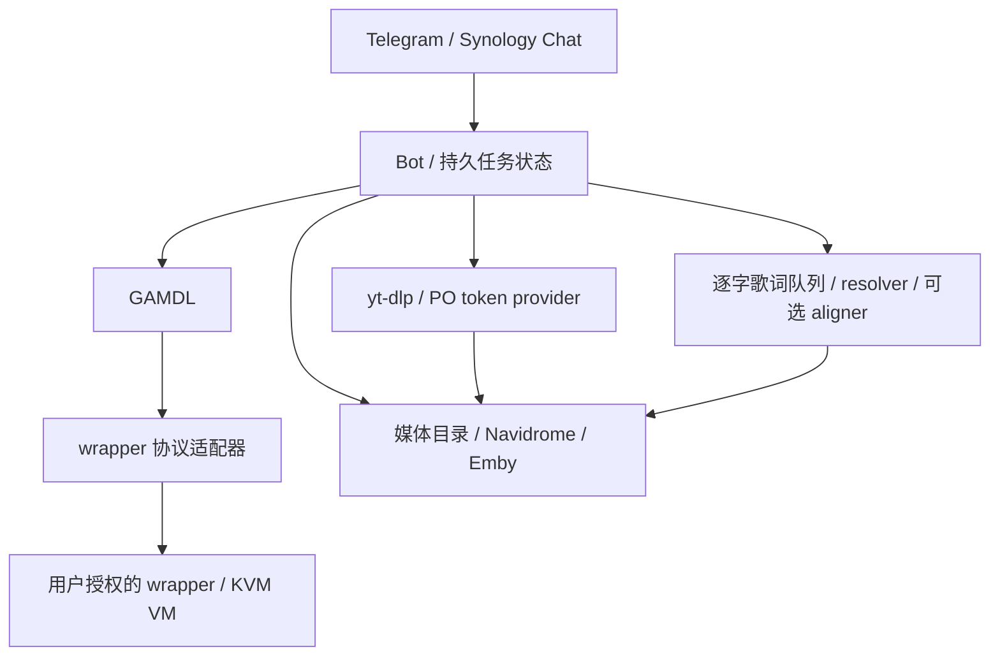

# Apple Music Downloader Bot

中文 · [English](README.en.md)

用于自托管 NAS 的 Telegram / Synology Chat 媒体入库服务：接收链接或搜索请求，通过 GAMDL、yt-dlp 与本地 wrapper 服务处理任务，并将媒体、封面和歌词写入指定目录。

这是从长期使用的 NAS 定制部署中整理的源码项目，包含服务代码、可移植部署模板与运维流程。**初始公开版本来自截至 2026-10-19 的本地维护资料；2026-10-21 整理时 NAS 的公网 IPv6 连接不可达，因此尚未核对线上最终文件，也未完成新环境的容器构建及真实账号验收。** 不应将它视为已验证的一键安装包。

## 功能

- Apple Music 文字搜索、分页选择、单曲 / 专辑 / 歌单任务，ALAC 与 Atmos 模式。
- 持久任务状态、媒体库索引与去重、下载进度卡片、失败反馈。
- YouTube / YouTube Music、哔哩哔哩音频与视频入库，可接入 Navidrome / Emby。
- LRC / TTML 歌词、逐字歌词来源匹配、持久队列、重试与通知。
- wrapper 协议适配、KVM 虚拟机启动支持、按需登录浏览器及限定服务范围的健康恢复。
- 备份、升级、回滚与故障排查流程。

部分能力需要独立的外部服务、模型或账号授权；详见部署配置和[运维手册](docs/OPERATIONS.zh-CN.md)。本仓库不附带媒体、Apple 账号、Cookie、设备凭据、wrapper 会话、虚拟机磁盘或模型权重。

## 架构



## 部署前

准备 Linux x86-64 NAS、Docker Compose、足够的磁盘空间；使用内置 VM 方案需要 `/dev/kvm`。先阅读[运维手册](docs/OPERATIONS.zh-CN.md)，检查根目录 `compose.yaml` 和 `.env.example`，再根据自己的存储路径、账号和网络填写配置。

```sh
cp .env.example .env
chmod 600 .env
# 编辑 .env，设置 bot token、允许访问的 chat ID、存储位置等
docker compose config --quiet
docker compose build
```

不要把 `docker compose config` 的完整输出贴到公开 issue，它可能包含展开后的凭据。Apple 服务需要由你自行完成有效订阅、wrapper 初始化和账号登录；没有这些状态时，容器启动并不代表下载功能可用。首次上线步骤以运维手册为准。

**同一个 Telegram token 只能有一个轮询器。** 已有生产服务时，先备份并安排切换，不要直接在旁边启动第二套 bot。建议为隔离验收单独申请测试 bot。

## 使用示例

发送 Apple Music 链接或歌名，或使用 `/search`、`/alac`、`/atmos`、`/both`、`/status`。YouTube 和哔哩哔哩链接可以选择音乐或视频用途；`/ytmusic` 和 `/ytvideo` 可指定用途。实际支持的行为以源码和 bot 的帮助信息为准。

## 开发与验证

```sh
python3 -m venv .venv
.venv/bin/python -m pip install -r requirements-test.txt
.venv/bin/python scripts/check_repo.py
.venv/bin/python scripts/run_tests.py
```

上述步骤安装测试依赖；实际服务依赖见 `requirements.txt` 与 Dockerfile。测试使用合成数据与临时目录，并禁止通过 Python socket 联网。离线单元测试不能替代有效账号下载、VM 冷启动、媒体扫描和断电恢复验收。验证结果与来源说明见 [SOURCE_SNAPSHOT.md](docs/SOURCE_SNAPSHOT.md)。

## 文档与许可

- [中文运维手册](docs/OPERATIONS.zh-CN.md) · [Operations guide](docs/OPERATIONS.en.md)
- [源码与验证范围](docs/SOURCE_SNAPSHOT.md)
- [敏感信息处理](SECURITY.md)
- [第三方许可说明](THIRD_PARTY_NOTICES.md)

本仓库原创代码采用 [MIT License](LICENSE)。第三方组件、OpenCC 派生字典及外部下载的工具遵循各自许可证，不能用本仓库的 MIT 许可替代。请仅处理你有权保存的内容，并遵守所使用服务的访问规则。本项目与 Apple、Google、哔哩哔哩及 Synology 无隶属关系。
