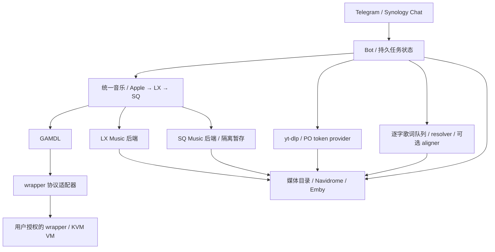

# Apple Music Downloader Bot

中文 · [English](README.en.md)

用于自托管 NAS 的 Telegram / Synology Chat 媒体入库服务：接收链接或搜索请求，通过 GAMDL、yt-dlp 与本地 wrapper 服务处理任务，并将媒体、封面和歌词写入指定目录。

这是从长期使用的 NAS 定制部署中整理的源码项目，包含服务代码、可移植部署模板与运维流程。**v0.2.0 新增一命令部署、完整私有备份与迁移恢复入口；真实 Docker / KVM 部署验收尚未运行，账号下载与播放仍需部署者验收。** 初始资料截至 2026-10-19，2026-10-21 已通过 IPv6 只读核对线上源码、挂载、依赖与已有媒体；[线上核对记录](docs/LIVE_CHECK_20261021.md)不能替代新安装验收。

## 功能

- Apple Music 文字搜索、分页选择、单曲 / 专辑 / 歌单任务，ALAC 与 Atmos 模式。
- LX Music、SQ Music 适配与可选后端部署；统一单曲入口按 Apple → LX → SQ 尝试同一录音的无损版本。
- 持久任务状态、媒体库索引与去重、下载进度卡片、失败反馈。
- YouTube / YouTube Music、哔哩哔哩音频与视频入库，可接入 Navidrome / Emby。
- YouTube 人工/自动字幕、中文或中文加原语双语 SRT/ASS；持久浏览器会话、Cookie 候选验证、原子更新与回滚。
- 可选 SABR 兼容路径，固定上游工具校验值并保留其许可；构建安装与运行启用分别选择。
- LRC / TTML 歌词、逐字歌词来源匹配、持久队列、重试与通知。
- wrapper 协议适配、KVM 虚拟机启动支持、按需登录浏览器及限定服务范围的健康恢复。
- 一命令准备完整套件、失败续装；默认包含媒体和镜像的私有备份、显式切换后的恢复，以及单服务升级、回滚。

部分能力需要网络和账号授权。[一命令部署](docs/ONE_COMMAND.zh-CN.md)会在部署者机器上获取固定依赖、模型并构建服务；仓库不附带媒体、Apple 账号、Cookie、设备凭据、wrapper 会话、虚拟机磁盘或模型权重。

## 架构



## 一命令部署

准备 Linux amd64、可读写的 `/dev/kvm`、Docker Engine、Compose 2.20+、Python 3.8+、Git 和 curl；默认要求至少 50 GiB 可用磁盘、6 GiB 可用内存。使用专用本地目录，账号须能操作 Docker 和 KVM。v0.2.0 的 tag 和 source release 发布后：

```sh
bash -o pipefail -c 'curl -fsSL https://raw.githubusercontent.com/zskruc/apple-music-downloader-bot/v0.2.0/install.py | sudo python3 - --root /srv/apple-music-downloader --with-media-servers'
```

这会准备 Bot、wrapper / KVM VM、LX、SQ / MySQL / 网易 API、YouTube PO provider、两个歌词 worker、按需认证浏览器与自愈配置；`--with-media-servers` 额外部署 Navidrome、Emby、LrcAPI。播放器管理端口仅绑定回环。安装不会代填账号、2FA、授权音乐源或 Emby 向导；没有安全的聊天入口和健康 wrapper 时 Bot 保持停止，状态会列出待配置项。示例通过 sudo 安装，后续维护也使用相同权限。

详见[中文完整指南](docs/ONE_COMMAND.zh-CN.md)：私有 JSON 配置、目录布局、断点续装、Cookie 持久化、包含媒体与镜像的停机备份、离线源归档及恢复切换。手动 Compose 部署继续见[运维手册](docs/OPERATIONS.zh-CN.md)。完整套件会启用歌词、SABR 和自动认证配置，与手动模板的默认关闭选项不同；Docker socket 配置需要信任部署主机。

**同一个 Telegram token 只能有一个轮询器。** 已有生产服务时，先备份并安排切换，不要直接在旁边启动第二套 bot。建议为隔离验收单独申请测试 bot。

## 使用示例

发送 Apple Music 链接或歌名，或使用 `/search`、`/alac`、`/atmos`、`/both`、`/status`。YouTube 和哔哩哔哩链接可以选择音乐或视频用途；`/ytmusic` 和 `/ytvideo` 可指定用途。实际支持的行为以源码和 bot 的帮助信息为准。

## 开发与验证

```sh
python3 -m venv .venv
.venv/bin/python -m pip install -r requirements-test.txt
.venv/bin/python scripts/check_repo.py
.venv/bin/python scripts/run_tests.py
```

上述步骤安装测试依赖；实际服务依赖见 `requirements.txt` 与 Dockerfile。测试使用合成数据与临时目录，Python socket 仅允许回环测试服务，禁止连接外部地址。隔离测试不能替代有效账号下载、VM 冷启动、媒体扫描和断电恢复验收。验证结果与来源说明见 [SOURCE_SNAPSHOT.md](docs/SOURCE_SNAPSHOT.md)。

## 文档与许可

- [中文运维手册](docs/OPERATIONS.zh-CN.md) · [Operations guide](docs/OPERATIONS.en.md)
- [一命令部署、备份与恢复](docs/ONE_COMMAND.zh-CN.md) · [English guide](docs/ONE_COMMAND.en.md)
- [固定依赖与许可来源](deploy/SOURCES.md) · [私有配置示例](deploy/private-config.example.json)
- [LX / SQ 配置与统一音乐](docs/MUSIC_SOURCES.zh-CN.md) · [English guide](docs/MUSIC_SOURCES.en.md)
- [LX 后端部署](services/lx-music/README.md) · [SQ 后端部署与任务补丁](services/sq-music/README.md)
- [YouTube Music、视频、字幕与 Cookie](docs/YOUTUBE.zh-CN.md) · [English guide](docs/YOUTUBE.en.md)
- [源码与验证范围](docs/SOURCE_SNAPSHOT.md)
- [敏感信息处理](SECURITY.md)
- [第三方许可说明](THIRD_PARTY_NOTICES.md)

本仓库原创代码采用 [MIT License](LICENSE)。第三方组件、OpenCC 派生字典及外部下载的工具遵循各自许可证，不能用本仓库的 MIT 许可替代。请仅处理你有权保存的内容，并遵守所使用服务的访问规则。本项目与 Apple、Google、哔哩哔哩及 Synology 无隶属关系。
